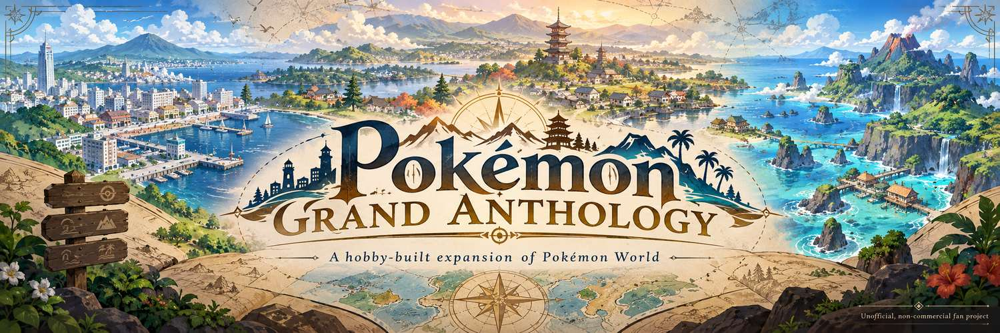

<p align="center">
  
</p>

# Pokémon Grand Anthology

**Three classic regions. Nine generations. One evolving adventure.**

An **unofficial, non-commercial, experimental hobby modification** built upon
[Pokémon World](https://github.com/evilchinesefood/PKMN-World) by David A. and its contributors.

[**Live Website**](https://grand-anthology.pages.dev/) · [**Origins**](#our-origins-built-upon-pokémon-world) · [**Field Guide**](docs/GRAND_ANTHOLOGY_FIELD_GUIDE.md) · [**Features**](#what-grand-anthology-adds) · [**Status**](#development-status-and-verification) · [**Build**](#building-locally) · [**Credits**](#credits-and-acknowledgments) · [**Roadmap**](#development-roadmap)

**Companion website:** [grand-anthology.pages.dev](https://grand-anthology.pages.dev/) includes the National Pokédex, indexed locations, Mega Stones and the seeded Randomizer Atlas. Cloudflare Pages' first production deployment succeeded on 27 October 2026. The website is a reference and development preview, **not a playable game or ROM download**.

> **Development preview, not a completed release.** The illustration above is original AI-generated project concept artwork, **not an in-game screenshot**. Grand Anthology is independent of and not endorsed by Pokémon World or the Pokémon rights holders.

## What is Pokémon Grand Anthology?

**Pokémon Grand Anthology** is a personal experiment in extending a classic, two-dimensional Pokémon adventure. Its goal is to preserve the recognizable **Kanto, Johto and Hoenn** campaigns while making Pokémon from **Generations 1–9** available across those three regions, alongside more convenient evolutions, collection systems and player options.

It is **not** an attempt to recreate nine full regions. The current world consists of Kanto, Johto, Hoenn and the connected travel hub inherited from Pokémon World. It is also not a polished, finished ROM hack: several mechanics are still being implemented, reconciled and tested.

## Our origins: built upon Pokémon World

**The foundation belongs to the original creators.** [Pokémon World](https://github.com/evilchinesefood/PKMN-World), developed by **David A. ([@evilchinesefood](https://github.com/evilchinesefood))** and its contributors, is the project that brings the three regional adventures into one GBA game. Its world, story integration, shared systems and substantial content are what make this extension possible.

Grand Anthology is a **separate, unofficial modification**, not an official successor, replacement, or competing claim to that work. We do not seek to undermine the creators, diminish their contributions, or suggest their endorsement. If the original three-region experience interests you, please visit the original project.

Pokémon World itself builds on [RHH's pokeemerald-expansion](https://github.com/rh-hideout/pokeemerald-expansion), [pret's pokeemerald](https://github.com/pret/pokeemerald), and work from other community projects, including [Pokémon Heart & Soul](https://github.com/PokemonHnS-Development/pokemonHnS). Their contributions are documented in the preserved [credits](CREDITS.md). For a component-level index of the notices included with the source, see [third-party notices](THIRD_PARTY_NOTICES.md).

## A hobby project built with ChatGPT

This is a **personal, non-commercial hobby project** guided by a Pokémon enthusiast. Its direction, feature priorities and design decisions are set by a human maintainer. Much of Grand Anthology's additional code, integration work, documentation and testing assistance is produced iteratively with **OpenAI's ChatGPT**.

That enthusiast is also, **by his own admission, a coward when it comes to punishing game difficulty**. Grand Anthology is therefore being designed first and foremost as a **casual, approachable adventure**: a place to explore three familiar regions, collect favorite Pokémon and enjoy the journey without making hardcore challenge the price of admission.

**A note for the record:** said enthusiast has also undertaken **multiple Rune Level 1 (RL1) runs in *Elden Ring*** and **will not accept slander** concerning his ability to endure difficult games. He simply prefers his Pokémon adventures without that particular flavor of suffering.

Optional tougher difficulty settings or balance revisions may be explored in the future, but they are not the default design goal. This is an **intended play style**, not a claim that every battle or progression curve has already been tuned or tested.

We say that openly because authorship and provenance matter. The extensive original Pokémon World codebase and its upstream components were **not** created by this project or by ChatGPT. AI-generated code may contain mistakes, and automated checks do not guarantee a reliable gameplay experience. We aim to describe what has actually been verified and correct defects as we find them.

The project exists for enjoyment, experimentation and learning, **not** to compete commercially with or displace anyone else's work.

## Three regions, one adventure

The following foundation is inherited from Pokémon World; Grand Anthology aims to preserve and extend it rather than rebuild it:

| Region | Foundation |
| --- | --- |
| **Kanto** | The familiar FireRed-style journey, rival, gyms, Elite Four and Champion. |
| **Johto** | A Johto campaign with its own locations, characters, gyms, League and associated events. |
| **Hoenn** | The Emerald adventure, its League and the Battle Frontier. |
| **World Transit** | A hub linking the regions, with shared trainer systems and region-specific progression. |

Grand Anthology's intended continuous adventure uses **one trainer, party, bag, Pokédex, PC and save**, preserving the active team when moving between regions while keeping regional badges and story progression distinct. Our preferred journey is **Kanto → Johto → Hoenn**; extensive cross-region and save/reload acceptance remains part of the development work. For a searchable Pokémon-and-item lookup across the three campaigns, use the **[Grand Anthology Field Guide](docs/GRAND_ANTHOLOGY_FIELD_GUIDE.md)**.

## What Grand Anthology adds

The public `main` branch has substantial source-level acquisition and encounter implementation. **Implemented in source** and **verified in gameplay** are different claims.

| Area | Current authored content |
| --- | --- |
| **National Pokédex** | All **1,025 species through Generation 9** have optimistic source-level acquisition paths, including breeding/evolutions and postgame. This is not a completed in-emulator collection. |
| **World ecology** | Native land, water, fishing and Rock Smash tables, plus rare and supplemental habitats across Kanto, Johto and Hoenn. Ultra Beasts and Paradox Pokémon can intentionally appear as rare natural species. |
| **Legendary/Mythical hunts** | Scripted or original story encounters across all three regions, including Mew's four-battle Nine Masks, the Johto Tao Trio, added Hoenn side chambers and many static location assignments. [Supported repeatable static encounters](FEATURES.md#repeatable-static-encounters-and-shiny-hunting) reroll the individual after a knockout or successful escape, enabling shiny hunting without save resets; specific battle and story restrictions still apply. |
| **Royal Duo** | Zacian and Zamazenta stand together on **Johto Route 27 after eight Johto badges, before the Champion**. Interact with either; winning one level-50 double battle awards both, holding their **Rusted Sword and Rusted Shield**. Actual gameplay QA is pending. |
| **Permanent special forms** | **Zygarde 10%** in Petalburg Woods, **50%** in Meteor Falls and a separate **permanent Complete Zygarde** on Hoenn Route 101 after Hoenn Champion. Regular Terapagos on Route 114 and a separate **permanent Stellar Terapagos** in Cave of Origin B1F after Hoenn Champion. |
| **Mega Stones** | **92/92** Mega Stones have source-level acquisition references: **30** hard-rematch rewards, **21** Battle Net vendor options and **41** world pickups. Thirteen also have a free starter-choice option. Pickup accessibility and full gameplay function need testing. |
| **Starter choices and convenience** | Source features include 10 Kanto, 9 Johto and 9 Hoenn starter options; offline evolution paths and player convenience systems. Full in-game acceptance remains a separate milestone. |

### Player progression and locations

**[Open the Grand Anthology Field Guide](docs/GRAND_ANTHOLOGY_FIELD_GUIDE.md)** for searchable National Pokédex entries, all numbered items, all 92 Mega Stone sources, a map-by-map index, major boss encounter requirements and the intended Kanto → Johto → Hoenn journey.

The encounter engineering milestone **does not imply postgame placement**. The Royal Duo is explicitly **pre-Johto-Champion**. In contrast, permanent Complete Zygarde and permanent Stellar Terapagos unlock **after Hoenn Champion**. **Eternatus is now authored as a level-55 static** in a chamber off Johto Victory Road 1F; the League-side meteorite only permits entry after the Royal Duo victory. Gameplay acceptance is pending.

For future engineering agents, the [machine-readable acquisition catalog](data/catalog/world_acquisition.jsonl) and [catalog instructions](data/catalog/README.md) are linked directly from [AGENTS.md](AGENTS.md). These source-indexed paths supersede older placement snapshots when those snapshots conflict with current code.

## Development status and verification

**Status (25 October 2026): public experimental source on `main`, not a finished ROM release or fully verified three-region game.**

Source publication began on October 23, 2026. The [public GitHub Actions workflows](https://github.com/DevElectrum/grand-anthology/actions) run source validators, optimized GBA compilation and representative emulator smoke tests. The [October 25 optimized P0 build and source-validation run #40234899967](https://github.com/DevElectrum/grand-anthology/actions/runs/40234899967) **passed**. The earlier [mGBA smoke #40231997639](https://github.com/DevElectrum/grand-anthology/actions/runs/40231997639) **passed** on its own earlier commit; it did **not** execute end-to-end Royal Duo/92-stone/1,025-Pokémon acceptance.

The maintainer has separately reported a successful **Mew Nine Masks** sequence and final catch/revisit, recorded in [its implementation and manual QA note](docs/MEW_NINE_MASKS_IMPLEMENTATION_2026-10-25.md). This does not automatically validate other battles.

**Outstanding acceptance:** walkability and overworld object interactions; actual Royal Duo win/reward persistence, storage overflow and form changes; collectible Mega Stone pickups; story flags and encounters after region changes; breeding and evolution edges; catching/revisiting; full-game Pokedex source realization and save/reload reliability. The field guide and structured catalog are navigational/source aids, **not playtesting certificates**.

## Screenshots

**Grand Anthology gameplay screenshots are pending consolidated emulator verification.** We will publish captures from this modification when they accurately represent the tested build.

For a preview of the **underlying** game's three-region presentation, see [Pokémon World's screenshots](https://github.com/evilchinesefood/PKMN-World/tree/master/graphics/branding/screenshots/showcase). Those are **upstream images**, not evidence that Grand Anthology's added features are functioning.

## Building locally

This repository contains GBA source, data and build tools; **it does not provide downloadable ROM files**. The current inherited Makefile still names its output `pokemonworld.gba`; that filename is a technical legacy detail, not an assertion that this project is the official Pokémon World release.

You need Git, Python 3, GNU Make, host build tools, `libpng` development headers, and a modern `arm-none-eabi` compiler/binutils/newlib toolchain. The project uses **modern compilation, not agbcc**. See [INSTALL.md](INSTALL.md) for platform-specific setup.

```sh
git clone https://github.com/DevElectrum/grand-anthology.git
cd grand-anthology
make release -j4
```

**Important:** The full-generation roster has previously required the optimized release-style build shown above to fit the GBA ROM size limit. This is **not a guarantee** that every in-progress commit compiles or runs correctly. The optimized GBA build and source-validation workflow passed on October 25, 2026, at [run #40234899967](https://github.com/DevElectrum/grand-anthology/actions/runs/40234899967); full gameplay validation remains unfinished. `make modern` is an inherited non-release invocation and should not be assumed to fit this development branch. Check the exact commit's CI and emulator evidence before treating a build as verified. Keep ROM outputs local; never upload them to GitHub Releases, Actions artifacts, or the repository.

For source-level checks and test tooling, consult [INSTALL.md](INSTALL.md) and the project documentation. Never interpret a green static validator alone as full gameplay acceptance.

## Saves, storage and current limitations

The current baseline PC storage remains **14 boxes × 30 slots = 420 Pokémon**. A larger external archive has been explored separately, but it is **not an integrated in-game feature**, and a 1,025-species *living* Pokédex is not currently supported by those 420 slots. National Pokédex caught registration is designed to remain recorded even if an individual Pokémon is released.

Do not assume compatibility with existing Pokémon World or earlier Grand Anthology saves. **Back up original `.sav` files before experimenting**, especially when switching commits, ROMs, or emulators. Save migration, forms, battle state, encounters and multi-region continuity still require broader validation.

Android and other emulator support are goals to check in practice, not guarantees. Details and deferred storage ideas appear in the [public development status](docs/PUBLIC_STATUS.md).

## Feedback and contributions

Thoughtful bug reports and improvements are welcome as this hobby project develops. When reporting a bug, please include the **commit or build used**, emulator and platform, whether the save is new or migrated, steps to reproduce, what you expected and what happened. Use the eventual public source repository's Issues tab when available.

Please avoid submitting copyrighted ROM binaries, ripped game assets without appropriate permission, personal save files containing sensitive information, or secrets. Proposed contributions should preserve upstream attribution and any applicable file-specific license notices. Contributions may be reviewed, revised or declined; there is no promised support schedule.

## Project principles, copyright and distribution

Grand Anthology is an **unofficial, free, non-commercial fan hobby project**. It is not affiliated with, authorized by, sponsored by, or endorsed by **Nintendo, Game Freak, The Pokémon Company, the Pokémon World team, or the other upstream project teams**. Pokémon names, characters and associated intellectual property remain the property of their respective owners.

We intend to respect the original [Pokémon World](https://github.com/evilchinesefood/PKMN-World) project's published practices and the rights and applicable terms of every upstream contributor. In particular:

- **No ROM distribution:** do not publish compiled `.gba` files through this repository, GitHub Releases, GitHub Actions artifacts, or affiliated downloads. Builds are for local use.
- **No commercial use:** the project is not for sale and does not offer paid builds, monetized access, or paid ROM downloads.
- **Attribution preserved:** retain the original project's extensive [CREDITS.md](CREDITS.md), source notices and file-specific third-party license requirements; identify Grand Anthology additions separately.
- **No implied permission:** public source availability, these acknowledgments and this README **do not create a license** to assets or code that the rights holders have not licensed. We will investigate requests and concerns about material and make corrections where appropriate.

The original project has not been verified to publish a blanket license authorizing unrestricted derivative-source redistribution. We do **not** claim such a permission here; anyone considering reuse must examine each source and its terms independently. **Respectful intent is not a substitute for permission.**

## Credits and acknowledgments

Grand Anthology would not exist without the original contributors and the community work they assembled:

- **[Pokémon World](https://github.com/evilchinesefood/PKMN-World):** David A. and contributors, for the interconnected Kanto, Johto, Hoenn adventure and the integrated game foundation.
- **[RHH / pokeemerald-expansion](https://github.com/rh-hideout/pokeemerald-expansion):** the underlying modernized Emerald engine, battle systems and extensive community contributions.
- **[pret / pokeemerald](https://github.com/pret/pokeemerald):** the foundational Emerald decompilation project.
- **[Pokémon Heart & Soul](https://github.com/PokemonHnS-Development/pokemonHnS)** and other credited creators: source material, Johto assets, community features and art as documented by Pokémon World.
- **Grand Anthology project direction:** an independent hobby maintainer, with extensive ChatGPT-assisted implementation, iteration and documentation.

**The complete inherited credits and contributor acknowledgments remain in [CREDITS.md](CREDITS.md).** Listing groups here is not meant to replace the individual credits there or imply that any upstream contributor endorses this modification.

## Development roadmap

This is a **plan, not a promised schedule**. The [current project scope](docs/PUBLIC_STATUS.md) takes precedence over older, conflicting roadmap language. The current world's scope remains **Kanto, Johto and Hoenn**.

<details>
<summary><strong>P0: finish the playable core</strong></summary>

- Maintain the **1,025/1,025 optimistic source-level acquisition inventory**; do not imply all species are actually catchable merely because a route exists in code.
- Validate the newly authored Royal Duo, permanent Complete Zygarde and Stellar Terapagos, Mega Stone world pickups, evolution branches, offline requirements and original story gates.
- Reconcile proposed-but-unimplemented dependencies separately, notably Eternatus's potential Victory Road relocation.
- Complete consolidated emulator acceptance for catching, encounter persistence, storage overflow, breeding, fossils, Pokédex rewards, regional travel and save/reload.

</details>

<details>
<summary><strong>P1: additional gameplay and quality-of-life improvements</strong></summary>

- Preserve casual, approachable play as the default design goal; harder difficulty modes or balance revisions, if added, should remain optional.
- Pursue the other approved optional improvements to progression, encounter rates, movement, speed, convenience and statistics without delaying the playable core.

</details>

<details>
<summary><strong>Deferred storage expansion</strong></summary>

- Explore significantly larger, durable storage and search only after the core experience is satisfactory.
- Maintain safe behavior for the original 420 slots and do not treat host-side prototypes as in-game functionality.

</details>

<details>
<summary><strong>Longer-term ideas</strong></summary>

- Preserve unselected suggestions as an exploratory backlog rather than promised features.
- No additional playable regions are part of the current project's target.

</details>

<details>
<summary><strong>P5: final-stage battle-mechanic experiments</strong></summary>

- Consider Dynamax, Gigantamax and Terastallization only after earlier work is satisfactory.
- Their presence in upstream engine code is not evidence that they work in Grand Anthology now.

</details>
